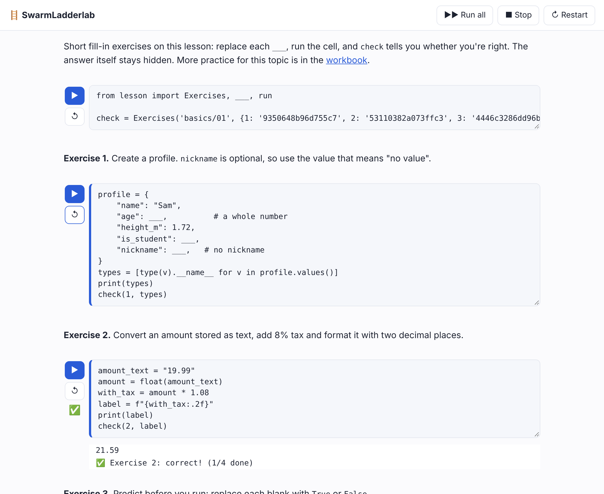
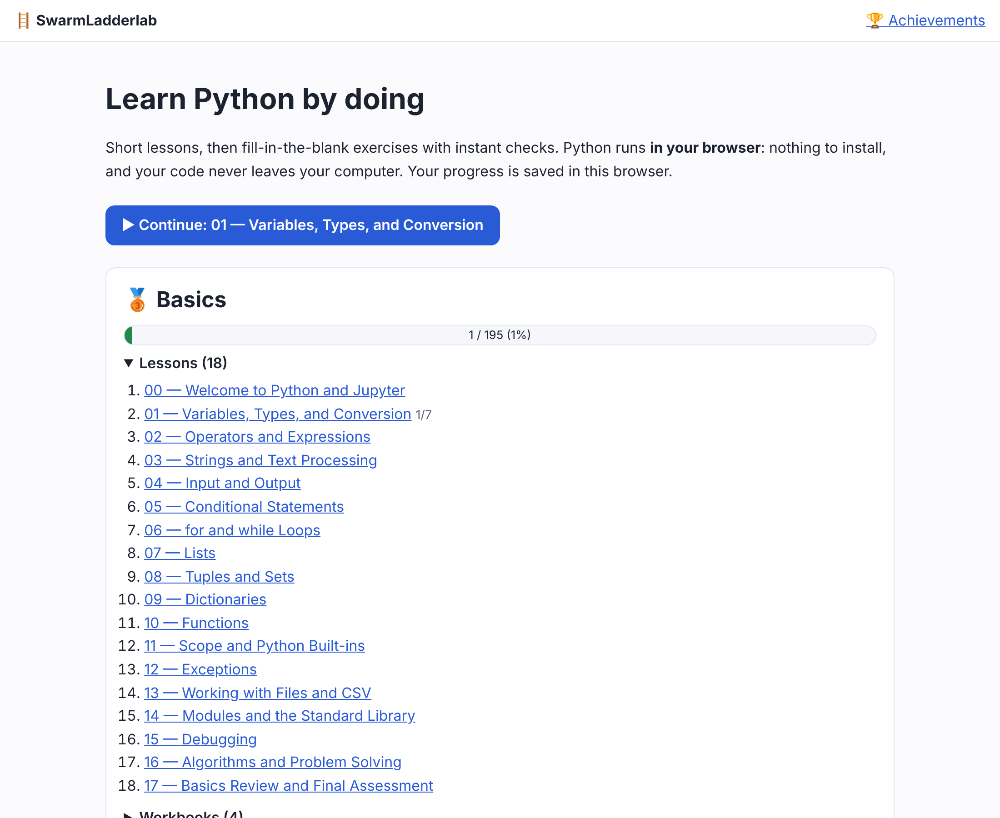

# 🪜 SwarmLadderlab

**Learn Python by doing, in your browser:** https://swarmladder.github.io/SwarmLadderlab/

 SwarmLadderlab is the web platform for the free [python-notebook](https://github.com/SwarmLadder/python-notebook) course: short lessons, fill-in-the-blank exercises with instant hidden-answer checks, quizzes, workbooks and projects. There's nothing to install.



## What learners get

- **Every lesson as a runnable page.** Edit any cell, press ▶ or Shift+Enter, and Python runs in the browser via [Pyodide](https://pyodide.org). Stop kills runaway code instantly.
- **Exercises with instant checks.** Fill in the `___` blanks; `check(...)` says ✅ or shows your result, never the answer. Workbook checks run the course's own pytest tests in the browser, with hints after repeated failures.
- **A progress dashboard** per level, plus "continue where you left off". Progress and your edits stay **in your browser**: no accounts and no tracking. Export and import a progress file to back it up.
- **Achievements.** When every workbook of a level passes, the claim page prepares your solutions and claim file for [ACHIEVEMENTS.md](https://github.com/SwarmLadder/python-notebook/blob/main/ACHIEVEMENTS.md).



## How it works

```
python-notebook (course)  ──build/build_site.py──▶  dist/  ──GitHub Pages──▶  learners
  *.ipynb, lesson.py,                                index.html, lesson.html, claim.html
  quiz.py, practice/                                 data/nb/*.json  (rendered notebooks)
                                                     course/...      (files Python needs)
```

- **No server.** It's a static site; Python runs in a Web Worker (`site/assets/py-worker.js`), so it's free to host and scales to any number of learners.
- **Same course, same checks.** The build reads the course repo directly. Notebooks become JSON with Markdown rendered at build time. `lesson.py`, `quiz.py`, `practice/` and the data files are copied into Pyodide's file system, so checks behave exactly as in Jupyter.
- **Browser limits.** Browsers can't start threads or processes, so the few cells that need them say so and link to Colab or Jupyter. `asyncio`, SQLite, files and pytest all work.

## Develop

```bash
git clone https://github.com/SwarmLadder/python-notebook ../python-notebook
python -m pip install markdown pytest
python build/build_site.py --course ../python-notebook --out dist
python -m http.server -d dist 8000      # open http://localhost:8000
```

Tests:

```bash
python -m pytest tests                  # build checks
node tests/e2e.cjs                      # end-to-end in headless Chromium (needs Playwright and network)
BASE_URL=https://swarmladder.github.io/SwarmLadderlab/ node tests/e2e.cjs   # same checks on the live site
```

## Deploy

`.github/workflows/deploy.yml` builds from the latest course on every push to `main`, every day, and on demand, then publishes to GitHub Pages.
One-time setup: **Settings → Pages → Build and deployment → Source: GitHub Actions**. Keep `deploy.yml` as the only Pages workflow: GitHub's suggested "static" or "Jekyll" workflows would publish the raw repository instead of the built site.

## License

Code: [MIT](LICENSE). Course content comes from python-notebook under CC BY 4.0.
